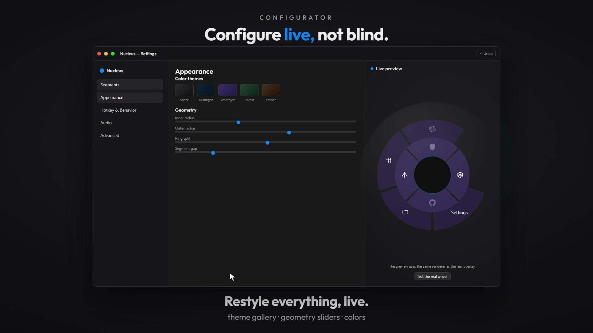

# Nucleus

*(formerly **Radial Wheel** — the app was renamed; settings from the old name migrate automatically on first launch)*

A polished, always-running radial launcher for Windows. Press a global hotkey and a
crisp, animated wheel pops up **at your mouse cursor** — click a segment to launch
apps, open URLs, run commands, replay keystroke macros, or trigger built-in Windows
actions. Everything is configurable from a real Settings window.

Built with Electron + vanilla web tech; keystroke synthesis and system actions go
straight to the Win32 API through `user32.dll` (via `koffi`).

[](media/promo/settings.mp4)

*Click the thumbnail to play — the Settings page adds and removes rings and segments, and recolors them on the **live preview**. The wheel is a real user's `config.json`. More films: **[horizontal 16:9](media/promo/wide.mp4)** · **[vertical 9:16](media/promo/vertical.mp4)** · **[square 1:1](media/promo/square.mp4)**.*

## Quick start

```powershell
npm install          # first time only (downloads the Electron runtime)
npm start            # launches tray-resident Nucleus
```

Default hotkey: **Ctrl + Alt + Space** — or use a mouse button instead: **Middle**, **Back**
or **Forward**, on their own or with modifiers (`Ctrl + Middle`). Change it in
Settings → **Hotkey & behavior** → *Change…*: press a combo, or click the button.
First launch opens the **Welcome guide** — four steps: what the wheel is, re-record your
hotkey (with a live "try the wheel" test), what to know, hand-off to Settings. On the
installed app, the last step can turn on start-with-Windows; a portable or development
copy does not register a login item. The hotkey and startup are both changeable anytime
in Settings. Replay the guide anytime from tray → **Show welcome…**.

- The app lives in the system tray — no taskbar entry, no console.
- Tray menu: Show wheel · Open Settings · Show welcome… · Reload config · Pause hotkey · Support Nucleus ♥ · Quit.
- Second launch (or double-clicking the tray icon) focuses Settings instead of duplicating.

## Using the wheel

- Open: the hotkey (wheel appears centered on the cursor; on small/secondary displays
  it clamps into view and shrinks to fit).
- Hover: segment highlights, the hub shows its icon + label.
- Select: left-click a segment. Dismiss: right-click, Esc, click the hub, or re-press the shortcut.
- **Drag to select** (Behavior, on by default): press, sweep across the wheel — folder fans
  branch as you pass — and release on a segment to fire it. Releasing off the wheel cancels.
  A plain click still works exactly as before (press + release on the same plate fires).
  Note: marking rides *left-button* presses; your summon trigger's own button (Middle/Back,
  when swallowed by the hook) is consumed before the wheel exists, so sweep-select from
  there starts with the next press.
- **Type to filter** (Behavior, on by default): with the wheel open, just start typing —
  non-matching segments fade back, the selection jumps to the best match (folder contents
  included; fans branch to reach them) and Enter fires it. Backspace edits, Esc clears the
  query first and dismisses on the second press.
- Mouse-button shortcut: by default the wheel **swallows** that click, so it behaves like a
  real hotkey and the app underneath never sees it (Middle click stops pasting while it is
  your summon key). Behavior → **Let the mouse button through to the app under the cursor**
  switches to detect-only: the wheel pops *and* the app gets its Back / Forward / paste.

### Action types
| type | `value` example | note |
|---|---|---|
| `app` | `notepad.exe`, `C:\\Tools\\foo.exe --flag`, or pick from the installed-programs dropdown | program / Start Menu shortcut (dropdown or Browse…). The **Arguments** box (`args`) passes launch parameters — quote values that contain spaces |
| `url` | `https://gmail.com` | default browser |
| `file` | `C:\\Docs\\notes.md` | opens with its registered handler |
| `command` | `taskkill /f /im foo.exe` | detached shell command |
| `macro` | `ctrl+c, wait=0.2, ctrl+v` · `type:hello` · `click, scroll=3` | real SendInput keys **and** mouse |
| `sys` | `lock`, `mute`, `screenshot`, `wifi`, … | built-in Windows actions |
| `setting` | `toggle_wheel_sound`, `toggle_game_mode`, … | flips one Nucleus setting on the spot (dropdown picker, app icon by default) |
| `folder` | — (no value) | sub-menu that branches outward on hover |
| `recent` | — (no value) | self-filling sub-menu of your most-recently-used segments; you edit only its label/icon |

`sys` values: `lock sleep screenshot show_desktop task_manager exit_app mute volume_up
volume_down sound explorer recycle_bin settings wifi bluetooth notifications night_light
display power clipboard_history emoji_picker set_output_device set_input_device`
(the last two carry a device: the editor lists your live audio endpoints and the
segment makes the chosen one the system default when it fires — same mechanism as
`explorer`'s folder box).

`setting` values (each is a live toggle, same switches as the Settings window):
`toggle_wheel_sound toggle_labels toggle_marking toggle_type_filter toggle_retrigger
toggle_dismiss_escape toggle_dismiss_rightclick toggle_click_through
toggle_focus_existing toggle_profiles toggle_game_mode toggle_autostart`.

### Macros

A `macro` segment replays a comma-separated script through `SendInput`
(`src/main/macro.js`). Keyboard and mouse steps mix in one spec:

| step | example | note |
|---|---|---|
| chord | `ctrl+shift+s`, or a lone `a` | `+` joins keys; released in reverse order, so a mid-run failure can never leave Ctrl stuck down |
| literal text | `type:hello, world` | Unicode via `KEYEVENTF_UNICODE`; **must be the last step** — it consumes the rest of the string, commas included |
| pause | `wait=0.2` | seconds; clamped to 5 s each |
| mouse button | `click` `rclick` `mclick` `dblclick` `back` `forward` | left / right / middle / double-left / XBUTTON1 / XBUTTON2 — press **and** release at the current cursor position |
| wheel | `scroll=3`, `scroll=-2` | notches in one event; positive = down, negative = up (max 25) |
| hold | `hold=ctrl+c=1.5`, `hold=f15` | press, hold, release in reverse; default 0.5 s, max 5 s |
| repeat | `repeat=3:ctrl+v` | re-runs one step 1–20×; cannot wrap `wait=`, `type:` or another `repeat=` |

Bounds are enforced **before** a single event is injected — so no spec, not
even one fired from Settings → **Try**, can overrun the resident process:
2048 characters, 128 steps, 15 s of combined waits/holds/repeats. Injection is
paced (~12 ms between events, 8 ms per typed character) because fast target
apps drop unhurried input.

Mouse steps land wherever the pointer sits when the macro runs — the plate you
just clicked; the wheel hides first, so the click reaches whatever was under
it. Aim deliberately, or give the target a `wait=` beat to settle.

## Settings

Open from the tray (double-click icon → **Open Settings**). Five tabs:

- **Segments** — add / edit / reorder / delete items on any ring, **+ Add ring**
  grows the wheel outward (up to 4 rings; remove the outermost anytime),
  icon picker (Segoe Fluent glyphs, a [Dashboard Icons](https://dashboardicons.com)
  logo, or your own image), per-item color, live “try this action” button,
  file browse for apps, and an **installed-programs dropdown** when type is `app`:
  type to search the Start Menu + registry program list, click to fill the target
  (entries launch exactly like double-clicking their Start Menu shortcut; ↻ re-scans).
  At the top, an **Editing** bar switches the whole editor + live preview between the
  **default wheel** and any **app profile** — a profile owns its own rings and its own
  comma-separated exe list, and takes over the wheel whenever one of those apps has
  focus (enable under Hotkey & Behavior; up to 8 profiles, first match wins).
- **Appearance** — hub/wheel size, ring split (two-ring layouts; three or more
  rings divide equally), rotation, gaps, label size, pop
  animation, colors + 14 theme presets, center label. Live preview uses the exact
  same renderer as the real wheel.
- **Hotkey & Behavior** — press-to-record hotkey with instant registration (conflicts
  are reported and the old key stays active); the recorder accepts the keyboard or a
  **Middle / Back / Forward mouse button** (`mmiddle`, `ctrl+mback`, … — one trigger at a
  time, mouse replaces the keyboard combo and vice versa), with **Let the mouse button
  through to the app under the cursor** to choose between swallowing the click and
  detect-only. Start-with-Windows toggle,
  dismiss options, **Drag to select** / **Type to filter** wheel gestures,
  a **Sound feedback** toggle (soft synthesized hover/select ticks, off by
  default — generated on the fly with Web Audio, no audio files),
  a **Focus an app that's already open** switch (off by default — when a
  program segment fires and that app already owns a window, its existing
  window is raised instead of launching a second copy; applies to `.exe`
  segments — shortcuts, scripts and links always open as before),
  a **Recent items show** slider (how full a `recent` fan gets), and
  **Use a different wheel per app** — the app-profile master switch.
  Plus **Gaming mode**: the wheel turns itself off (hotkey
  included) while the focused app covers a whole monitor — exclusive or
  borderless-fullscreen games — or while one of your listed programs
  (comma-separated exe names, e.g. `fortnite.exe`) has focus. It switches back
  on when the app closes or you alt-tab away; the tray tooltip and menu say
  why the hotkey is off, and tray → **Show wheel** still works as an override.
  Profiles reuse this same focus probe — sampled once per wheel opening, nothing
  runs in the background while both features are off.
- **Audio** — change the system **default output and input devices** from a live
  picker (friendly names, the current default marked), set **master volume and
  mute** for each direction, and run a **per-app volume mixer**: every program
  currently playing audio gets its own slider and mute button, exactly like the
  Windows Volume Mixer. Everything reads back from Windows, so the panel stays
  honest when something else changes the volume; the list refreshes itself
  while the tab is visible and does nothing while it isn't. The same four
  controls — both device pickers, master, and the app list — also sit in the
  **`mixer` segment's flyout beside the wheel** (no `<select>` popups there:
  the endpoint list opens inside the card, so the overlay never loses
  activation). The two device
  pickers double as the data source for the `set_output_device` /
  `set_input_device` wheel segments (below). An **Open Windows sound settings**
  button is the escape hatch for device properties and formats.
- **Advanced** — export / import config, **Export package… (with icons)** — one
  JSON file carrying the config plus the bytes of every custom segment image, so
  a shared setup arrives fully decorated (import accepts either format; icon
  payloads are content-address-verified on the way in, mismatched art is skipped
  to the glyph fallback), **Restore a backup…** (the rolling config backups, see
  below), a **Usage** panel listing your most-fired segments with counts and
  last-used times, **Clear recent-items data**, open the config folder,
  action type reference, a **Support Nucleus** card (donate via PayPal — see
  [Support the project](#support-the-project)), exit.

All edits autosave (debounced) to:

```
%APPDATA%\Nucleus\config.json
```

Before **Import…** or **Reset to defaults** replaces that file, the outgoing
config is copied to `%APPDATA%\Nucleus\backups` as
`config-20261004-063015-import-r12.json`; the newest **12** are kept. Ordinary
autosaves join that rotation at most once every 5 minutes (and never when the
content didn't change), so a burst of typing can't bury the copies that matter —
the destructive actions always get theirs. **Restore a backup…** opens a picker
rooted in that folder; the replacement is itself backed up and the toast's
**Undo** puts the previous config straight back.

The file is watched — hand-edit it and the running wheel picks changes up
(hotkey re-registers too). If it ever becomes invalid JSON, the app keeps the
last-good config and leaves your broken file next to it as `config.json.bad`.
Your original `wheel_config.json` from the Python prototype (in `archive/`) is
imported automatically on first run.

## Packaging (optional but recommended for daily use)

```powershell
npm run dist    # bumps build.buildNumber in package.json, then → dist/:
                #    Nucleus-1.0.0-b1-portable.exe         (no-install single exe)
                #    Nucleus-1.0.0-b1-setup.exe            (one-click NSIS installer)
```

Every `dist` run increments that build number (also stamped into the exe's
Windows `FileVersion`, e.g. `1.0.0.1`, and into the generated
`src/main/build-info.js` that the log banner and welcome screen's version line
read). When cutting a new `version`, reset `build.buildNumber` to `"0"` in
`package.json` to start the series over.

Packaged builds are the recommended way to run long-term: the Start-with-Windows
entry (registry value `local.nucleus` under `HKCU\Software\Microsoft\Windows\CurrentVersion\Run`)
then points at the real exe and carries the app icon (in dev mode it points at
Electron). Install the Setup exe, launch it once, and it lives in the tray from then on.

To launch from source with no console (e.g. a Startup entry during development):
`wscript scripts\launch-hidden.vbs`.

## Notes & limits

- Macros type into whatever window has focus after the wheel closes; that's
  standard SendInput behavior. `wait=` steps space things out.
- `sleep` uses the standard `SetSuspendState` call — if hibernation is enabled it
  hibernates instead (that's Windows, not the app).
- Icons come from **Segoe Fluent Icons** (Win 11) with **Segoe MDL2 Assets**
  (Win 10) fallback; the picker shows exactly what a glyph will look like.
- **Custom segment images**: in the icon picker, **Browse image…** takes a local
  **PNG, JPG, GIF, WebP, BMP, ICO** or **SVG** file (up to 2 MB), or paste an
  image **URL** and hit **Use URL**. The bytes are stored once, content-addressed,
  under `%APPDATA%\Nucleus\icons\custom` and `config.json` keeps only a
  `custom:<hash>.<ext>` key — so configs stay small and shareable. A pasted URL is
  downloaded once and kept, so the wheel shows it offline too; a URL-sourced icon
  re-downloads itself on a new machine, while one picked from disk falls back to
  that segment's glyph. Either way nothing renders blank. Files are validated by
  their bytes, not their extension, and an ``-loaded SVG cannot run script.
- No acrylic/backdrop blur behind the overlay (a transparent Electron window can
  only blur its own content) — depth comes from shadows + tuned fills.
- If a global hotkey fails to register at startup (taken by another app), the app
  keeps running, shows a tray balloon, and flags it red in Settings.
- A **mouse-button** shortcut rides a `WH_MOUSE_LL` low-level hook, so it needs the same
  koffi input bridge the macros use. If that bridge can't load (non-Windows, broken
  install) the trigger reports it in Settings and you pick a keyboard combo instead —
  nothing else degrades. Inside the hook, any unexpected error lets the click reach the
  app rather than swallow it (fail-open: a broken hook must never eat your mouse).
  Quitting unhooks it, so Middle click goes back to being an ordinary Middle click.
- Some mice report the Back / Forward button id in the **high word** of the hook event's
  `mouseData` instead of the documented low word; Windows apps then ignore those buttons
  entirely (they "do nothing"). Nucleus reads either word, so the side buttons still
  summon the wheel on such mice.
- Gaming mode samples the foreground window every ~1.5 s while enabled (zero cost
  when off; pause fires after ~3 s, resume is immediate). Fullscreen video players
  and remote-desktop windows count as "fullscreen apps" too. It reads the
  foreground process name via Win32 — an admin-elevated game may hide its exe
  name from a non-elevated app, in which case the app-list match can't fire but
  fullscreen detection still does. If the Win32 probe is unavailable the wheel
  simply never pauses (fail-open).
- **App profiles** resolve at the moment of summon — ONE foreground probe per wheel
  opening (no polling at all while the switch is off), the same probe and fail-open
  doctrine as Gaming mode: no match / no probe / our own window focused → the
  default wheel. An empty profile never activates for the same reason. Profile
  rings live inside config.json — export, import, and the live file-watch all apply
  to them like any other setting.
- **Recent segments** are filled by main at summon time from a usage sidecar
  (`state.json` — never config.json, so exports, packages and shares carry zero
  statistics). The fan ranks **most-recently-used first** (fire count only breaks
  ties). Only REAL wheel clicks count; Settings "Try" runs don't pollute
  recents. Clicking an item inside a recent fan executes the real segment with
  that id (every click passes the same live-config id match); the container
  itself launches nothing. In the live preview a recent plate shows as its
  glyph + label — contents appear on the real wheel.
- **Export packages** embed only custom (disk-picked) icon bytes — Dashboard logos
  and URL-sourced art re-download themselves, so they stay out of the file. Every
  payload is re-hashed on import against its claimed content-addressed key; a
  tampered entry is skipped, and its segment falls back to the glyph rather than
  rendering someone else's art.

## Development

```
src/main/       main process (config store, hotkeys, mouse-button hook, SendInput macros, tray, windows, IPC)
src/preload/    contextBridge surface (no nodeIntegration anywhere)
src/renderer/   wheel overlay + settings UI (vanilla ESM, shared wheel-core renderer)
scripts/        icon generator, hidden-launch vbs
archive/        the original Python prototype + its config
```

Debugging a mouse trigger: `npm run start:agent -- --mouse-hook-probe` prints the hook's
counters whenever they change — `calls` (every event the proc was handed), `seen` (events
for the armed button), `fired`, `swallowed`, `injectedIgnored`, plus a `buttons` histogram
keyed by Win32 message id and the last decoded `mouseData` / `flags`. `calls` rising while
`seen` stays 0 means the button never reaches the hook (vendor driver remap, or another
app's hook took it first). Dev builds only — inert once packaged.

## Manual test checklist

1. `npm start` → tray icon appears, no console/taskbar window; first-run opens the Welcome guide (replay via tray → Show welcome…; seen-state in `state.json`).
2. Ctrl+Alt+Space over any window/monitor → wheel pops centered on the cursor with animation.
3. Launch: Browser (url), Notes (app), Screenshot (sys), Lock (sys, then sign back in).
4. Add a macro item `type:hello world`, open Notepad, fire it — text appears.
5. Reorder/delete/re-ring items → preview + real wheel update instantly; restart app → persisted.
6. Record a new hotkey (e.g. Ctrl+Alt+J); old one stops working, new one works; try a
   known-taken combo → error shown, previous hotkey still active.
6b. Record **Middle click** as the shortcut (or `Ctrl+Middle`); it summons the wheel and
   Middle click no longer pastes/autoscrolls. Tick **Let the mouse button through** →
   the wheel pops *and* the app still gets the click. Record `Back`/`Forward` over a
   browser: swallowed by default, so no navigation. Re-record a keyboard combo →
   the mouse hook goes away (Middle click behaves normally again). Tray → Pause hotkey
   and Gaming mode must silence the mouse trigger too; **Quit** must leave the mouse
   fully normal (no leaked hook).
7. Settings → Startup off/on → check `HKCU\Software\Microsoft\Windows\CurrentVersion\Run`.
8. Edit config.json in a text editor → running wheel reflects it within a second.
9. Break config.json (`{oops`) → app survives on last-good config; file saved as `.bad` on next reload attempt.
10. Run `npm start` again → Settings window focuses, no second tray icon.
11. Profiles: Settings → Segments → **+ Profile**; name it, list `notepad.exe`, add
    segments to its rings. Behavior → **Use a different wheel per app** on → focus
    Notepad, summon → the PROFILE wheel pops; focus anything else → the default.
    Switch the master off → always default. Restart → persisted; hand-edit the
    profile's rings in config.json → the running wheel picks it up.
12. Marking: press on a plate, drag across others (folder fans branch as you sweep),
    release → the plate under release fires; release off the wheel → nothing happens.
    A plain click still fires. Turning **Drag to select** off restores press-time firing.
13. Type to filter: summon, type `calc` → non-matches dim, Calculator selected,
    Enter launches it; Backspace edits the query; Esc once clears it, Esc again dismisses
    (and honors the Esc-dismiss setting). A match inside a closed folder opens the fan.
14. Recents: add a **recent** segment; fire several actions from the real wheel;
    re-summon → its fan holds the most-recently-used items (hover to branch, click to run —
    macro timing intact). `state.json` keeps the counts; config.json stays clean.
    Advanced → **Clear recent-items data** → the fan goes empty until you use the wheel again.
15. Package: pick a disk image as a segment icon → Advanced → **Export package…**:
    the file carries config + icon. Delete/rename `%APPDATA%\Nucleus\icons\custom`,
    then **Import…** the package → icons come back with no network (plain-exported
    configs still import exactly as before, minus the art).
16. Sound: Behavior → tick **Sound feedback** → summon; the selection (pointer
    hover or arrow keys) ticks softly per segment change, and firing adds a
    higher tick. Unticked → complete silence (no AudioContext is ever created).
    The first hover of a cold pop may be inaudible until the first click/Enter
    unlocks the audio context (browser autoplay policy) — never an error or delay.
17. Focus existing app: open Notepad, tick Behavior → **Focus an app that's
    already open…**, fire an `app` segment pointing at `notepad.exe` → the open
    window comes to the front (minimized ones are restored) and NO second copy
    starts. Close Notepad → firing the same segment launches it again. Unticked
    → every fire launches a new instance exactly as before.
18. Macro mouse steps (**injects real input — aim the cursor first**): a `macro`
    segment `click, wait=0.3, rclick, scroll=3, hold=ctrl+c=1, repeat=2:ctrl+v` over
    a Notepad + Explorer window: left click, right click (menu), three wheel notches
    down, Ctrl held a second while typing `c`, then Ctrl+V twice. A step that
    overruns the bounds — e.g. `repeat=99:click` or 20 × `wait=5` — is refused with
    a balloon before anything is typed, and the wheel stays usable.
19. Backups: Advanced → **Import…** a different config → the config is copied to
    `%APPDATA%\Nucleus\backups`
    gains `config-<timestamp>-import-r<n>.json` holding the config it
    replaced; **Restore a backup…** opens right there, and its toast **Undo** puts
    the previous config back. Type 20 edits in a row → the autosaves do NOT each add
    a backup (one at most per 5 min); save 13 forced replacements → only the newest
    12 files remain.
20. Usage panel: fire a few segments from the real wheel → Advanced → **Usage**
    lists them most-fired first, with the ring / folder path / profile each lives in,
    the `n×` count and a relative last-used time; the summary reports total fires and
    any orphan counts from deleted segments. Settings **Try** buttons add nothing
    (by design). **Clear recent-items data** empties the panel and the `recent` fans.
21. Audio: Settings → **Audio** tab → the Output/Input pickers list the real
    endpoints with the current default marked `· default`; the Master volume
    slider and mute move the Windows values (visible in the tray mixer — and
    changes made elsewhere flow back into the panel while the tab is open).
    Start something playing → it appears under **App volume** with its own
    slider + mute, affecting only that app. Segments → add a `sys`
    **Set audio output device** segment, bind a device in its picker, fire it
    from the real wheel → that device becomes the system default (an unplugged
    binding fails with a balloon naming the reason, never silently). On an image
    where no app may change the default, both pickers carry a line saying so and
    pointing at the **Open Windows sound settings** button, rather than failing
    only after the click.
22. Mixer card: add a `mixer` segment, fire it from the real wheel → the card
    opens with **Output** / **Input** rows naming the endpoint Windows currently
    uses for each direction. Open one (the endpoint list opens *inside* the card — the wheel
    stays up; there is no Windows dropdown to steal activation), click another
    endpoint → the Windows default flips (check Settings → Sound), the row
    re-reads the new default, and the master slider + app list follow it,
    since both track the default endpoint. The list caps at five endpoints with
    a `…and N more` line; Esc closes an open list first, then the card. A
    refused switch (device busy/gone, or an OS image where no app may change the
    default) says why in plain words on the card's note line — never a silent
    no-op — and names **Windows sound settings** as the door still left. On such
    an image the card opens with that line already showing: levels and app rows
    stay live, only the switch is impossible.

## Support the project

Nucleus is free, open, and ad-free — designed, built, and maintained in my
spare time. If the wheel has earned a place on your desktop and you'd like to
support me and my work, every donation directly funds more features, fixes,
and polish.

[](https://www.paypal.com/paypalme/kurtishight)

**→ https://www.paypal.com/paypalme/kurtishight**

The same link lives in the app: **Settings → Advanced → Support Nucleus** (or
the quiet heart link at the bottom of the Settings sidebar), and in the tray
menu under **Support Nucleus ♥**. Thank you! — *Kurtis Hight*
